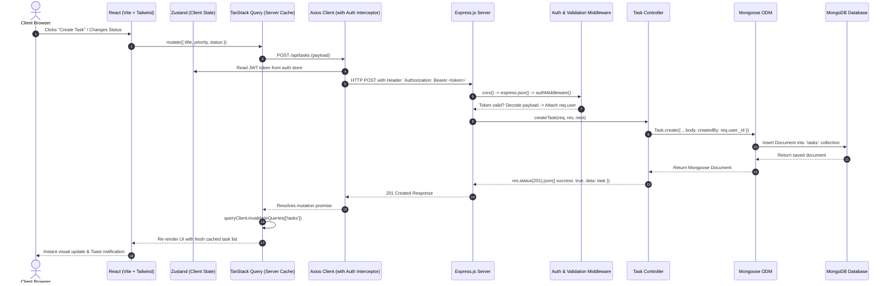

# MERN Full-Stack Architecture — Lean Hands-On Crash Course

> **Designed for B.Tech 3rd/4th-year students and Junior Full-Stack Developer candidates.**  
> A strict, sequential, production-grade 3.5-hour roadmap to build **DevPulse** — a real-world developer issue & task tracking system — from an empty folder to a deployed-ready full-stack application. Every lesson provides exact implementation steps, package audits, code architecture patterns, ready-to-paste AI build prompts, and interview defense criteria.

---

## 0. Course Summary & Mental Model — Read This First

### What This Is

A 3-to-4 hour maximum, hands-on, zero-fluff intensive crash course. It cuts through outdated tutorial conventions (like using `useEffect` for data fetching or managing global server cache in Redux) and teaches how modern engineering teams build full-stack web applications in 2026.

### The Vehicle: "DevPulse" (Developer Issue & Task Tracking System)

You will not build a trivial "Hello World" or a generic, unauthenticated todo app that impresses no interviewer. You will build **DevPulse**, a streamlined task and bug tracker for engineering teams with:

- Secure JWT-based User Authentication (Registration, Login, Role-aware scoping).
- Task/Bug Life-cycle Management (Title, Description, Status: `todo` | `in-progress` | `done`, Priority: `low` | `medium` | `high`, Assignee, Creator).
- Filterable task boards, instant search, and real-time state synchronization.
- Server state managed via **TanStack Query v5** (automated caching, background refetching, mutation invalidations).
- Client UI state & auth session managed via **Zustand** (lightweight, decoupled from component render cycles).
- Fully validated REST API with custom Express middleware and Mongoose ODM models.

---

### Modern MERN Architecture & Complete Request-Response Flow



---

## 0.5 Modern Stack Verification & Standards (2026)

Before writing code, understand the architectural choices that differentiate a junior developer from an entry-level professional:

| Domain                | Modern Standard (Used Here)          | Legacy Anti-Pattern (Avoid)                | Why It Matters in Interviews                                                                            |
| --------------------- | ------------------------------------ | ------------------------------------------ | ------------------------------------------------------------------------------------------------------- |
| **Build Tool**        | **Vite** (ESBuild/Rollup)            | `create-react-app` (Webpack)               | CRA is deprecated and dead. Vite provides instantaneous HMR and optimized production bundles.           |
| **Server State**      | **TanStack Query v5**                | `useEffect` + `useState` fetching          | `useEffect` lacks deduplication, caching, background invalidation, and race-condition handling.         |
| **Client State**      | **Zustand**                          | Prop drilling or Redux Toolkit boilerplate | Zustand has near-zero boilerplate, no context re-render thrashing, and native localStorage persistence. |
| **Module System**     | **ES Modules (`import/export`)**     | CommonJS (`require/module.exports`)        | Node.js 20+ natively supports ESM. Consistent syntax across both frontend and backend.                  |
| **Styling**           | **Tailwind CSS**                     | Plain CSS files / SCSS spaghetti           | Utility-first styling with zero runtime cost, co-located in markup for rapid UI assembly.               |
| **Password Security** | **`bcryptjs`** with salt factor 10   | Plain text / simple md5/sha256             | Salting and adaptive key derivation prevent rainbow table attacks.                                      |
| **Error Handling**    | Centralized Express error middleware | Try/catch with scattered `res.status(500)` | Uniform API error contract (`{ success: false, message: ... }`) prevents leaky stack traces.            |

---

## 0.6 Master Lesson Plan & Time Allocation (Total: 225 Mins / 3h 45m)

```
[Backend Core — 1h 45m]
├── Lesson 01: Monorepo & Backend Workspace Architecture (20m)
├── Lesson 02: MongoDB Connection & Mongoose Schemas (20m)
├── Lesson 03: Authentication Core — bcryptjs & JWT (25m)
├── Lesson 04: Middleware Pipeline, Validation & Centralized Error Handling (20m)
└── Lesson 05: Task CRUD REST API — Business Logic & Controllers (20m)

[API Verification — 15m]
└── Lesson 06: API Verification with Thunder Client / cURL / Postman (15m)

[Frontend Core — 1h 25m]
├── Lesson 07: Vite + React Setup, Tailwind CSS & Axios Interceptor (20m)
├── Lesson 08: Client State with Zustand — Auth Store & Session (20m)
├── Lesson 09: React Router v6/v7, Protected Routes & Auth Forms (25m)
└── Lesson 10: Server State with TanStack Query v5 — Queries & Mutations (20m)

[Integration & Defense — 35m]
├── Lesson 11: Task Board UI, Filters, Skeletons & Edge States (15m)
└── Lesson 12: Production Build, Deployment Prep & MERN Technical Interview Defense (20m)
```

---

## 1. Lesson 01 — Monorepo & Backend Workspace Architecture

### 🎯 Objective

Initialize a structured, clean full-stack workspace with Node.js ES Modules, configure backend dependencies, environment variable isolation, and a fail-fast health-check endpoint.

### 🧠 Why This Matters

Interviewers look at project organization within 10 seconds. Junior devs throw `server.js` in the root and write all logic in one file. Real teams use a **layered architectural separation**: routes route, controllers coordinate, models define schema, and middleware handles cross-cutting concerns.

### ⏱️ Estimated Time

**20 Minutes**

### 📥 Dependencies & Tooling

In your project root (`projects/devpulse/`):

```bash
mkdir -p devpulse/server devpulse/client
cd devpulse/server
npm init -y
npm pkg set type="module"
npm install express dotenv cors helmet
npm install -D nodemon
```

| Package         | Purpose                                                                                            |
| --------------- | -------------------------------------------------------------------------------------------------- |
| `express`       | Web application framework for routing and middleware.                                              |
| `dotenv`        | Loads environment variables from `.env` into `process.env`.                                        |
| `cors`          | Configures Cross-Origin Resource Sharing headers so the React client can communicate with Express. |
| `helmet`        | Sets HTTP response security headers (CSP, X-Frame-Options, HSTS).                                  |
| `nodemon` (dev) | Automatically restarts the Node process when file changes are saved.                               |

### 🛠️ What To Build

Folder structure for `server/`:

```text
server/
├── .env
├── .env.example
├── .gitignore
├── package.json
└── src/
    ├── app.js             # Express app configuration & middleware
    ├── server.js          # HTTP server listener & DB connection entry
    ├── config/
    │   └── db.js          # Database connection
    ├── controllers/       # Request handlers
    ├── middleware/        # Auth, error, and validation middleware
    ├── models/            # Mongoose schemas
    └── routes/            # Route declarations
```

### 💻 Code Architecture Pattern

`server/src/app.js`:

```javascript
import express from "express";
import cors from "cors";
import helmet from "helmet";

const app = express();

// Security & Parsing Middleware
app.use(helmet());
app.use(
  cors({
    origin: process.env.CLIENT_URL || "http://localhost:5173",
    credentials: true,
  }),
);
app.use(express.json());

// Healthcheck Route
app.get("/health", (req, res) => {
  res.status(200).json({
    status: "ok",
    uptime: process.uptime(),
    timestamp: new Date().toISOString(),
  });
});

export default app;
```

`server/src/server.js`:

```javascript
import dotenv from "dotenv";
dotenv.config();

import app from "./app.js";

const PORT = process.env.PORT || 5000;

app.listen(PORT, () => {
  console.log(
    `🚀 DevPulse Server running in ${process.env.NODE_ENV || "development"} mode on port ${PORT}`,
  );
});
```

`server/.env`:

```env
PORT=5000
NODE_ENV=development
CLIENT_URL=http://localhost:5173
MONGO_URI=mongodb://localhost:27017/devpulse
JWT_SECRET=devpulse_super_secret_jwt_key_2026
JWT_EXPIRES_IN=7d
```

### 🤖 AI Build Prompt

```text
In `projects/devpulse/server`, generate a production-ready Node.js ES module backend structure:
1. `package.json` with "type": "module" and scripts: "dev": "nodemon src/server.js", "start": "node src/server.js"
2. `src/app.js` configuring helmet, cors (configured for origin localhost:5173 with credentials: true), express.json(), and a GET /health route returning JSON { status: "ok", timestamp }. Export app.
3. `src/server.js` loading dotenv and listening on process.env.PORT || 5000.
4. `.env` and `.env.example` with PORT, NODE_ENV, CLIENT_URL, MONGO_URI, JWT_SECRET, and JWT_EXPIRES_IN.
5. `.gitignore` ignoring node_modules and .env.
```

### 💡 Key Concepts to Understand

- **`app.js` vs `server.js` separation**: Decoupling Express app definition from HTTP server `.listen()` allows supertest to run automated integration tests without binding to a physical network port.
- **Node.js ESM (`"type": "module"`)**: Enables top-level await, native `import/export`, and aligns client and server JavaScript standards.

### ✅ Done When

- Running `npm run dev` in `server/` outputs the server start message.
- `curl http://localhost:5000/health` returns `{"status":"ok", ...}` with HTTP 200.

---

## 2. Lesson 02 — MongoDB Connection & Mongoose Schemas

### 🎯 Objective

Connect Node.js to MongoDB (Atlas or local) using Mongoose with resilient connection pooling, and define strictly-typed schemas for `User` and `Task` with validation and relational references.

### 🧠 Why This Matters

MongoDB is schemaless at the database level. Mongoose provides the application-level schema safety needed in production. Knowing how to implement field validators, enums, timestamps, and foreign key references (`ObjectId` + `ref`) is a staple junior interview requirement.

### ⏱️ Estimated Time

**20 Minutes**

### 📥 Dependencies & Tooling

```bash
cd devpulse/server
npm install mongoose
```

### 🛠️ What To Build

1. `server/src/config/db.js` — Resilient connection function with error handling.
2. `server/src/models/User.js` — Schema for users with email regex and role enums.
3. `server/src/models/Task.js` — Schema for tasks with foreign key reference to `User`.

### 💻 Code Architecture Pattern

`server/src/config/db.js`:

```javascript
import mongoose from "mongoose";

export const connectDB = async () => {
  try {
    const conn = await mongoose.connect(process.env.MONGO_URI);
    console.log(
      `🍃 MongoDB Connected: ${conn.connection.host} [DB: ${conn.connection.name}]`,
    );
  } catch (error) {
    console.error(`❌ MongoDB Connection Error: ${error.message}`);
    process.exit(1); // Fail-fast: exit process if DB is unreachable
  }
};
```

`server/src/models/User.js`:

```javascript
import mongoose from "mongoose";

const userSchema = new mongoose.Schema(
  {
    name: {
      type: String,
      required: [true, "Please provide a name"],
      trim: true,
      maxlength: [50, "Name cannot exceed 50 characters"],
    },
    email: {
      type: String,
      required: [true, "Please provide an email"],
      unique: true,
      trim: true,
      lowercase: true,
      match: [
        /^\w+([.-]?\w+)*@\w+([.-]?\w+)*(\.\w{2,3})+$/,
        "Please provide a valid email",
      ],
    },
    password: {
      type: String,
      required: [true, "Please provide a password"],
      minlength: [6, "Password must be at least 6 characters"],
      select: false, // Never return password in queries by default
    },
    role: {
      type: String,
      enum: ["developer", "lead", "admin"],
      default: "developer",
    },
  },
  { timestamps: true },
);

export default mongoose.model("User", userSchema);
```

`server/src/models/Task.js`:

```javascript
import mongoose from "mongoose";

const taskSchema = new mongoose.Schema(
  {
    title: {
      type: String,
      required: [true, "Please provide a task title"],
      trim: true,
      maxlength: [100, "Title cannot exceed 100 characters"],
    },
    description: {
      type: String,
      trim: true,
      default: "",
    },
    status: {
      type: String,
      enum: ["todo", "in-progress", "done"],
      default: "todo",
    },
    priority: {
      type: String,
      enum: ["low", "medium", "high"],
      default: "medium",
    },
    assignedTo: {
      type: mongoose.Schema.Types.ObjectId,
      ref: "User",
      default: null,
    },
    createdBy: {
      type: mongoose.Schema.Types.ObjectId,
      ref: "User",
      required: true,
    },
  },
  { timestamps: true },
);

// Compound index for fast queries: fetching user's tasks sorted by creation date
taskSchema.index({ createdBy: 1, status: 1 });

export default mongoose.model("Task", taskSchema);
```

### 🤖 AI Build Prompt

```text
In `projects/devpulse/server`:
1. Create `src/config/db.js` that connects to process.env.MONGO_URI using mongoose.connect(), logging host and DB name on success, and calling process.exit(1) on failure.
2. Wire `connectDB()` into `src/server.js` before `app.listen()`.
3. Create `src/models/User.js` with fields: name, email (unique, lowercase, regex validated), password (min 6 chars, select: false), role ('developer' | 'lead' | 'admin'), and timestamps: true.
4. Create `src/models/Task.js` with fields: title, description, status ('todo' | 'in-progress' | 'done'), priority ('low' | 'medium' | 'high'), assignedTo (ObjectId ref 'User'), createdBy (ObjectId ref 'User', required), and compound index { createdBy: 1, status: 1 }.
```

### 💡 Key Concepts to Understand

- **`select: false` on password**: Prevents accidental leakage of hashed passwords in `find()` queries unless explicitly opted into via `.select('+password')`.
- **Compound Indexes**: An index on `{ createdBy: 1, status: 1 }` enables MongoDB to satisfy queries filtering by user and status via an index scan rather than a slow collection scan.

### ✅ Done When

- Starting the server (`npm run dev`) shows `MongoDB Connected` in the console.
- If an invalid `MONGO_URI` is supplied, the server logs the error and immediately exits with code 1.

---

## 3. Lesson 03 — Authentication Core: Password Hashing & JWT

### 🎯 Objective

Implement secure authentication using `bcryptjs` for salted password hashing and `jsonwebtoken` for signing and verifying stateless tokens.

### 🧠 Why This Matters

Authentication is the #1 area interviewers probe to verify if a candidate understands backend security. Storing plain passwords or storing secrets in code immediately disqualifies a candidate.

### ⏱️ Estimated Time

**25 Minutes**

### 📥 Dependencies & Tooling

```bash
cd devpulse/server
npm install bcryptjs jsonwebtoken
```

### 🛠️ What To Build

1. Mongoose `pre('save')` hook and `matchPassword` method on `User.js`.
2. Utility function `generateToken(userId)` to create signed JWTs.
3. Auth controller (`register`, `login`, `getMe`) in `server/src/controllers/authController.js`.
4. Auth routes in `server/src/routes/authRoutes.js`.

### 💻 Code Architecture Pattern

Upgrade `server/src/models/User.js`:

```javascript
import bcrypt from "bcryptjs";

// Pre-save hook: Hash password before saving if modified
userSchema.pre("save", async function (next) {
  if (!this.isModified("password")) return next();
  const salt = await bcrypt.genSalt(10);
  this.password = await bcrypt.hash(this.password, salt);
});

// Instance method to compare password during login
userSchema.methods.matchPassword = async function (enteredPassword) {
  return await bcrypt.compare(enteredPassword, this.password);
};
```

`server/src/utils/generateToken.js`:

```javascript
import jwt from "jsonwebtoken";

export const generateToken = (id) => {
  return jwt.sign({ id }, process.env.JWT_SECRET, {
    expiresIn: process.env.JWT_EXPIRES_IN || "7d",
  });
};
```

`server/src/controllers/authController.js`:

```javascript
import User from "../models/User.js";
import { generateToken } from "../utils/generateToken.js";

export const register = async (req, res, next) => {
  try {
    const { name, email, password, role } = req.body;

    const userExists = await User.findOne({ email });
    if (userExists) {
      return res.status(400).json({
        success: false,
        message: "User already exists with this email",
      });
    }

    const user = await User.create({ name, email, password, role });
    const token = generateToken(user._id);

    res.status(201).json({
      success: true,
      data: {
        _id: user._id,
        name: user.name,
        email: user.email,
        role: user.role,
        token,
      },
    });
  } catch (error) {
    next(error);
  }
};

export const login = async (req, res, next) => {
  try {
    const { email, password } = req.body;
    if (!email || !password) {
      return res
        .status(400)
        .json({ success: false, message: "Please provide email and password" });
    }

    // Must explicitly select password because schema has select: false
    const user = await User.findOne({ email }).select("+password");
    if (!user || !(await user.matchPassword(password))) {
      return res
        .status(401)
        .json({ success: false, message: "Invalid credentials" });
    }

    const token = generateToken(user._id);

    res.status(200).json({
      success: true,
      data: {
        _id: user._id,
        name: user.name,
        email: user.email,
        role: user.role,
        token,
      },
    });
  } catch (error) {
    next(error);
  }
};
```

### 🤖 AI Build Prompt

```text
In `projects/devpulse/server`:
1. Add `pre('save')` hook to `User.js` to hash `this.password` with `bcrypt.genSalt(10)` only when modified.
2. Add instance method `matchPassword(enteredPassword)` on `User.js` using `bcrypt.compare()`.
3. Create `src/utils/generateToken.js` exporting `generateToken(id)` using `jwt.sign({ id }, process.env.JWT_SECRET, { expiresIn: '7d' })`.
4. Create `src/controllers/authController.js` with `register` and `login` handlers adhering to the exact contract: return `{ success: true, data: { _id, name, email, role, token } }`.
5. Create `src/routes/authRoutes.js` routing POST /register to register, and POST /login to login. Mount it in `app.js` at `/api/auth`.
```

### 💡 Key Concepts to Understand

- **`isModified('password')`**: Essential guard in Mongoose pre-save hooks. Without this, updating a user's name would re-hash the already hashed password string, permanently locking the user out.
- **JWT Payload Minimization**: Never store sensitive data (passwords, social security numbers) inside a JWT payload; JWTs are Base64URL-encoded and readable by anyone who inspects the token. Store only the user `_id`.

### ✅ Done When

- `POST /api/auth/register` with `{ "name": "John Doe", "email": "john@test.com", "password": "password123" }` returns HTTP 201 with JWT token.
- Submitting wrong password to `POST /api/auth/login` returns HTTP 401.

---

## 4. Lesson 04 — Middleware Pipeline, Validation & Centralized Error Handling

### 🎯 Objective

Protect private endpoints with an `authMiddleware` JWT guard, validate incoming payloads, and replace unstructured error responses with a standardized Express error-handling middleware.

### 🧠 Why This Matters

In production, errors will happen: invalid ObjectIds, duplicate emails, malformed JSON, expired tokens. Without centralized error handling, server crashes leak stack traces or hang connections. A uniform error format makes client-side integration with TanStack Query frictionless.

### ⏱️ Estimated Time

**20 Minutes**

### 🛠️ What To Build

1. `server/src/middleware/authMiddleware.js` — Extracts `Bearer <token>`, decodes ID, attaches `req.user`.
2. `server/src/middleware/errorMiddleware.js` — Catch-all 4-parameter Express error handler translating Mongoose errors (CastError, ValidationError, code 11000) to clean HTTP responses.
3. `GET /api/auth/me` endpoint protected by `protect`.

### 💻 Code Architecture Pattern

`server/src/middleware/authMiddleware.js`:

```javascript
import jwt from "jsonwebtoken";
import User from "../models/User.js";

export const protect = async (req, res, next) => {
  let token;

  if (
    req.headers.authorization &&
    req.headers.authorization.startsWith("Bearer")
  ) {
    token = req.headers.authorization.split(" ")[1];
  }

  if (!token) {
    return res.status(401).json({
      success: false,
      message: "Not authorized to access this route, no token provided",
    });
  }

  try {
    const decoded = jwt.verify(token, process.env.JWT_SECRET);
    req.user = await User.findById(decoded.id).select("-password");
    if (!req.user) {
      return res.status(401).json({
        success: false,
        message: "User belonging to this token no longer exists",
      });
    }
    next();
  } catch (error) {
    return res.status(401).json({
      success: false,
      message: "Not authorized, token failed or expired",
    });
  }
};
```

`server/src/middleware/errorMiddleware.js`:

```javascript
export const notFound = (req, res, next) => {
  const error = new Error(`Not Found - ${req.originalUrl}`);
  res.status(404);
  next(error);
};

export const errorHandler = (err, req, res, next) => {
  let statusCode = res.statusCode === 200 ? 500 : res.statusCode;
  let message = err.message;

  // Mongoose Bad ObjectId (CastError)
  if (err.name === "CastError" && err.kind === "ObjectId") {
    statusCode = 404;
    message = "Resource not found: Invalid ID format";
  }

  // Mongoose Duplicate Key Error (code 11000)
  if (err.code === 11000) {
    statusCode = 400;
    const field = Object.keys(err.keyValue)[0];
    message = `Duplicate value entered for ${field} field. Please use another value`;
  }

  // Mongoose Validation Error
  if (err.name === "ValidationError") {
    statusCode = 400;
    message = Object.values(err.errors)
      .map((val) => val.message)
      .join(", ");
  }

  res.status(statusCode).json({
    success: false,
    message,
    stack: process.env.NODE_ENV === "production" ? null : err.stack,
  });
};
```

Mounting in `server/src/app.js`:

```javascript
// At the bottom of app.js, after all route mounts:
import { notFound, errorHandler } from "./middleware/errorMiddleware.js";

app.use("/api/auth", authRoutes);
// (Task routes will be mounted here in Lesson 5)

app.use(notFound);
app.use(errorHandler);
```

### 🤖 AI Build Prompt

```text
In `projects/devpulse/server`:
1. Create `src/middleware/authMiddleware.js` exporting `protect`:
   - Checks `req.headers.authorization` for `Bearer <token>`.
   - Verifies JWT with `process.env.JWT_SECRET`.
   - Finds user with `User.findById(decoded.id).select('-password')` and attaches to `req.user`.
   - Returns 401 on missing, invalid, or expired tokens.
2. Add `getMe` handler in `authController.js` returning `res.json({ success: true, data: req.user })`.
3. Add route `router.get('/me', protect, getMe)` in `authRoutes.js`.
4. Create `src/middleware/errorMiddleware.js` exporting `notFound` and `errorHandler` (handling CastError, 11000 duplicate key, ValidationError).
5. Mount `notFound` and `errorHandler` at the end of `src/app.js`.
```

### 💡 Key Concepts to Understand

- **The 4-argument signature of Express Error Handlers**: Express recognizes error-handling middleware _only_ if the function explicitly declares exactly four parameters: `(err, req, res, next)`. Omitting `next` causes Express to treat it as standard middleware, breaking error propagation.
- **Fail-Safe Sanitization**: Stack traces contain server file paths and internal logic; hiding `err.stack` when `NODE_ENV === 'production'` prevents information leakage to attackers.

### ✅ Done When

- Making a request to `GET /api/auth/me` without a token returns `401 Unauthorized`.
- Passing `Authorization: Bearer <valid_token>` returns the user data with `200 OK`.
- Requesting an unknown route like `GET /api/unknown` returns `404 Not Found` in uniform JSON format.

---

## 5. Lesson 05 — Task CRUD REST API: Business Logic & Controllers

### 🎯 Objective

Implement complete CRUD operations for the `Task` resource with user ownership enforcement, query filtering by status/priority, and pagination support.

### 🧠 Why This Matters

Real-world full-stack apps don't just dump all database rows into a response. They enforce authorization: a user should only update or delete tasks they own (or have permission to manage). Query filtering (`?status=todo`) prevents over-fetching.

### ⏱️ Estimated Time

**20 Minutes**

### 🛠️ What To Build

1. `server/src/controllers/taskController.js`:
   - `getTasks`: Filter by status, priority; search title.
   - `getTaskById`: Fetch single task with populated creator.
   - `createTask`: Assign `createdBy: req.user._id`.
   - `updateTask`: Verify ownership before updating.
   - `deleteTask`: Verify ownership before deleting.
2. `server/src/routes/taskRoutes.js`: Protected REST endpoints mounted at `/api/tasks`.

### 💻 Code Architecture Pattern

`server/src/controllers/taskController.js`:

```javascript
import Task from "../models/Task.js";

// @route   GET /api/tasks
// @desc    Get all tasks with optional filters
export const getTasks = async (req, res, next) => {
  try {
    const { status, priority, search } = req.query;
    const query = { createdBy: req.user._id };

    if (status) query.status = status;
    if (priority) query.priority = priority;
    if (search) {
      query.title = { $regex: search, $options: "i" }; // Case-insensitive title search
    }

    const tasks = await Task.find(query)
      .populate("assignedTo", "name email")
      .sort({ createdAt: -1 });

    res.status(200).json({
      success: true,
      count: tasks.length,
      data: tasks,
    });
  } catch (error) {
    next(error);
  }
};

// @route   POST /api/tasks
// @desc    Create a new task
export const createTask = async (req, res, next) => {
  try {
    const { title, description, status, priority, assignedTo } = req.body;

    const task = await Task.create({
      title,
      description,
      status,
      priority,
      assignedTo: assignedTo || null,
      createdBy: req.user._id,
    });

    res.status(201).json({ success: true, data: task });
  } catch (error) {
    next(error);
  }
};

// @route   PUT /api/tasks/:id
// @desc    Update a task (owner only)
export const updateTask = async (req, res, next) => {
  try {
    let task = await Task.findById(req.params.id);

    if (!task) {
      return res
        .status(404)
        .json({ success: false, message: "Task not found" });
    }

    // Authorization check: Make sure user is task owner
    if (task.createdBy.toString() !== req.user._id.toString()) {
      return res.status(403).json({
        success: false,
        message: "Not authorized to update this task",
      });
    }

    task = await Task.findByIdAndUpdate(req.params.id, req.body, {
      new: true,
      runValidators: true,
    });

    res.status(200).json({ success: true, data: task });
  } catch (error) {
    next(error);
  }
};

// @route   DELETE /api/tasks/:id
// @desc    Delete a task (owner only)
export const deleteTask = async (req, res, next) => {
  try {
    const task = await Task.findById(req.params.id);

    if (!task) {
      return res
        .status(404)
        .json({ success: false, message: "Task not found" });
    }

    if (task.createdBy.toString() !== req.user._id.toString()) {
      return res.status(403).json({
        success: false,
        message: "Not authorized to delete this task",
      });
    }

    await task.deleteOne();

    res
      .status(200)
      .json({ success: true, message: "Task removed successfully" });
  } catch (error) {
    next(error);
  }
};
```

`server/src/routes/taskRoutes.js`:

```javascript
import express from "express";
import {
  getTasks,
  createTask,
  updateTask,
  deleteTask,
} from "../controllers/taskController.js";
import { protect } from "../middleware/authMiddleware.js";

const router = express.Router();

// Protect all task routes
router.use(protect);

router.route("/").get(getTasks).post(createTask);

router.route("/:id").put(updateTask).delete(deleteTask);

export default router;
```

### 🤖 AI Build Prompt

```text
In `projects/devpulse/server`:
1. Create `src/controllers/taskController.js` implementing:
   - `getTasks`: query filter by req.user._id, optional status, priority, and regex search on title. Populate 'assignedTo' with 'name email'. Sort -createdAt.
   - `createTask`: creates task setting createdBy = req.user._id.
   - `updateTask`: checks task existence, verifies task.createdBy.toString() === req.user._id.toString() (returns 403 if false), then updates with { new: true, runValidators: true }.
   - `deleteTask`: checks existence and ownership, calls task.deleteOne(), returns success message.
2. Create `src/routes/taskRoutes.js` protecting all routes with `protect`, mounting GET/POST on `/` and PUT/DELETE on `/:id`.
3. Mount `taskRoutes` in `app.js` at `/api/tasks`.
```

### 💡 Key Concepts to Understand

- **`ObjectId.toString()` comparison**: In Mongoose, `_id` is a BSON ObjectId object, not a string. `task.createdBy === req.user._id` evaluates to `false` even if they represent the identical hexadecimal ID. Always call `.toString()` when comparing IDs.
- **`runValidators: true` in `findByIdAndUpdate`**: By default, Mongoose runs schema validators only on `.save()` and `.create()`. You must explicitly supply `{ runValidators: true }` in update queries to prevent users from bypassing validation.

### ✅ Done When

- `POST /api/tasks` creates a task scoped to the logged-in user.
- `GET /api/tasks?status=todo` returns only `todo` tasks.
- Attempting to update a task owned by another user yields `403 Forbidden`.

---

## 6. Lesson 06 — API Verification & Automated Testing Script

### 🎯 Objective

Thoroughly test all REST endpoints (Auth + CRUD + Security Gates) using a lightweight Node.js test script or cURL, confirming all contracts before writing any React frontend code.

### 🧠 Why This Matters

**Never start building frontend UI against an unverified backend.** If a button click fails in React, beginners don't know whether the bug is in React state, Axios headers, CORS, or the database controller. Verifying the API independently isolates the backend contract.

### ⏱️ Estimated Time

**15 Minutes**

### 🛠️ What To Build

Create an automated test script `server/test-api.js` using native `fetch` (built into Node.js 18+) that tests the complete user journey in sequence.

### 💻 Code Architecture Pattern

`server/test-api.js`:

```javascript
const BASE_URL = "http://localhost:5000/api";

async function runTests() {
  console.log("🧪 Starting DevPulse Backend Verification...\n");

  // 1. Health check
  const healthRes = await fetch("http://localhost:5000/health");
  console.log(
    `[1] Healthcheck: ${healthRes.status === 200 ? "✅ PASS" : "❌ FAIL"}`,
  );

  // 2. Register User
  const testEmail = `dev_${Date.now()}@test.com`;
  const regRes = await fetch(`${BASE_URL}/auth/register`, {
    method: "POST",
    headers: { "Content-Type": "application/json" },
    body: JSON.stringify({
      name: "Test Dev",
      email: testEmail,
      password: "password123",
    }),
  });
  const regData = await regRes.json();
  console.log(`[2] Register User: ${regData.success ? "✅ PASS" : "❌ FAIL"}`);
  const token = regData.data?.token;

  if (!token) throw new Error("Cannot proceed without valid token");

  // 3. Get /me with Token
  const meRes = await fetch(`${BASE_URL}/auth/me`, {
    headers: { Authorization: `Bearer ${token}` },
  });
  const meData = await meRes.json();
  console.log(
    `[3] Verify Auth /me: ${meData.data?.email === testEmail ? "✅ PASS" : "❌ FAIL"}`,
  );

  // 4. Create Task
  const taskRes = await fetch(`${BASE_URL}/tasks`, {
    method: "POST",
    headers: {
      "Content-Type": "application/json",
      Authorization: `Bearer ${token}`,
    },
    body: JSON.stringify({
      title: "Fix Redis Connection Bug",
      description: "Timeout occurs after 3 retries in production",
      priority: "high",
      status: "in-progress",
    }),
  });
  const taskData = await taskRes.json();
  const taskId = taskData.data?._id;
  console.log(`[4] Create Task: ${taskData.success ? "✅ PASS" : "❌ FAIL"}`);

  // 5. Query Tasks with Filter
  const filterRes = await fetch(`${BASE_URL}/tasks?status=in-progress`, {
    headers: { Authorization: `Bearer ${token}` },
  });
  const filterData = await filterRes.json();
  console.log(
    `[5] Filter Tasks: ${filterData.count >= 1 ? "✅ PASS" : "❌ FAIL"}`,
  );

  // 6. Unauthorized access check (missing token)
  const unauthRes = await fetch(`${BASE_URL}/tasks`);
  console.log(
    `[6] Auth Guard (No Token): ${unauthRes.status === 401 ? "✅ PASS" : "❌ FAIL"}`,
  );

  console.log("\n🎉 All Backend Endpoints Verified and Production-Ready!");
}

runTests().catch((err) => console.error("❌ Test Runner Failed:", err.message));
```

### 🤖 AI Build Prompt

```text
In `projects/devpulse/server`:
Create a standalone executable script `test-api.js` using Node.js native fetch that tests:
1. GET /health
2. POST /api/auth/register with a dynamic unique email
3. GET /api/auth/me using the returned Bearer token
4. POST /api/tasks creating a task with status 'in-progress'
5. GET /api/tasks?status=in-progress asserting returned count is at least 1
6. GET /api/tasks without header asserting 401 response
Log clear pass/fail emojis for each test step and add "test:api": "node test-api.js" to package.json scripts.
```

### 💡 Key Concepts to Understand

- **Contract-Driven Testing**: Treating your REST API as an independent service before writing frontend consumers ensures your backend is decoupled and follows OpenAPI/REST conventions.
- **Idempotency in Seed/Test Scripts**: Generating unique emails (`dev_${Date.now()}@test.com`) prevents tests from failing due to Mongoose 11000 duplicate key errors on repeated runs.

### ✅ Done When

- Running `npm run test:api` passes all 6 assertion checks with green checkmarks.

---

## 7. Lesson 07 — Frontend Setup: Vite, Tailwind CSS & Axios Interceptor

### 🎯 Objective

Scaffold the React application using Vite, configure Tailwind CSS for modern utility styling, establish a feature-based folder structure, and build a centralized Axios HTTP client with automatic JWT token injection.

### 🧠 Why This Matters

Scattered `fetch` calls across components lead to code duplication, inconsistent base URLs, and broken authentication headers. An **Axios Interceptor** automatically grabs the latest JWT from storage and attaches it to every outgoing request, plus handles 401 errors globally.

### ⏱️ Estimated Time

**20 Minutes**

### 📥 Dependencies & Tooling

In your project directory (`projects/devpulse/`):

```bash
npm create vite@latest client -- --template react
cd client
npm install
npm install -D tailwindcss postcss autoprefixer
npx tailwindcss init -p
npm install axios lucide-react clsx tailwind-merge
```

| Package                   | Purpose                                                               |
| ------------------------- | --------------------------------------------------------------------- |
| `vite`                    | Next-generation frontend tooling with instant HMR.                    |
| `tailwindcss`             | Utility-first CSS framework.                                          |
| `axios`                   | Promise-based HTTP client for the browser with interceptors.          |
| `lucide-react`            | Clean, modern SVG icon library for UI controls.                       |
| `clsx` + `tailwind-merge` | Utility for conditionally merging Tailwind classes without conflicts. |

### 🛠️ What To Build

Folder structure for `client/`:

```text
client/src/
├── api/
│   └── client.js         # Axios instance & interceptors
├── components/
│   ├── ui/               # Reusable UI (Button, Input, Modal, Badge)
│   └── Navbar.jsx        # Navigation & user dropdown
├── features/
│   ├── auth/             # Login, Register, Auth forms
│   └── tasks/            # TaskCard, TaskBoard, TaskForm, TaskFilter
├── hooks/                # Custom React hooks
├── store/
│   └── useAuthStore.js   # Zustand client state (Lesson 8)
├── routes/
│   └── AppRoutes.jsx     # Router configuration (Lesson 9)
├── App.jsx
└── main.jsx
```

Configure `tailwind.config.js`:

```javascript
/** @type {import('tailwindcss').Config} */
export default {
  content: ["./index.html", "./src/**/*.{js,ts,jsx,tsx}"],
  theme: {
    extend: {},
  },
  plugins: [],
};
```

Add directives to `client/src/index.css`:

```css
@tailwind base;
@tailwind components;
@tailwind utilities;

body {
  @apply bg-slate-900 text-slate-100 min-h-screen font-sans;
}
```

### 💻 Code Architecture Pattern

`client/src/api/client.js`:

```javascript
import axios from "axios";

const api = axios.create({
  baseURL: import.meta.env.VITE_API_URL || "http://localhost:5000/api",
  headers: {
    "Content-Type": "application/json",
  },
});

// Request Interceptor: Attach JWT token if present in localStorage
api.interceptors.request.use(
  (config) => {
    const authStorage = localStorage.getItem("devpulse-auth");
    if (authStorage) {
      try {
        const { state } = JSON.parse(authStorage);
        if (state?.token) {
          config.headers.Authorization = `Bearer ${state.token}`;
        }
      } catch (e) {
        console.error("Error parsing auth token", e);
      }
    }
    return config;
  },
  (error) => Promise.reject(error),
);

// Response Interceptor: Handle 401s globally (token expiration)
api.interceptors.response.use(
  (response) => response,
  (error) => {
    if (error.response?.status === 401) {
      // Clear token and redirect if unauthorized
      localStorage.removeItem("devpulse-auth");
      if (window.location.pathname !== "/login") {
        window.location.href = "/login";
      }
    }
    return Promise.reject(error);
  },
);

export default api;
```

`client/.env`:

```env
VITE_API_URL=http://localhost:5000/api
```

### 🤖 AI Build Prompt

```text
In `projects/devpulse/client`:
1. Initialize Tailwind CSS by configuring `tailwind.config.js` content paths and updating `src/index.css` with `@tailwind` directives and dark-mode slate body styling.
2. Create `src/api/client.js` with an Axios instance pointing to `import.meta.env.VITE_API_URL || 'http://localhost:5000/api'`.
3. Add a request interceptor that reads the `devpulse-auth` key from localStorage and attaches `Authorization: Bearer <token>`.
4. Add a response interceptor that catches 401 errors, clears the storage, and redirects to `/login`.
5. Create `.env` with `VITE_API_URL=http://localhost:5000/api`.
```

### 💡 Key Concepts to Understand

- **`import.meta.env` vs `process.env`**: Vite exposes environment variables on `import.meta.env`, strictly requiring the `VITE_` prefix to prevent accidentally baking private server secrets into client-side JS bundles.
- **Request Interceptor vs Manual Headers**: Manually passing `{ headers: { Authorization: ... } }` in every component leads to missing auth bugs. Interceptors provide an un-bypassable security gate at the transport layer.

### ✅ Done When

- `npm run dev` starts the Vite dev server with Tailwind CSS styles active.
- Inspecting Network requests from `api.get('/health')` shows the correct base URL.

---

## 8. Lesson 08 — Client State Management with Zustand: Auth Store

### 🎯 Objective

Implement client-side state management using **Zustand** to manage user authentication, session data, and token persistence across browser reloads.

### 🧠 Why This Matters

For years, tutorials forced junior developers to install massive Redux Toolkit setups (actions, reducers, dispatchers, thunks) just to store a user object. Zustand accomplishes this in 25 lines of clean code, with zero Context re-rendering cascades and built-in `persist` middleware.

### ⏱️ Estimated Time

**20 Minutes**

### 📥 Dependencies & Tooling

```bash
cd devpulse/client
npm install zustand
```

### 🛠️ What To Build

`client/src/store/useAuthStore.js`:

- `user`: Authenticated user profile (`{ _id, name, email, role }`).
- `token`: Active JWT string.
- `isAuthenticated`: Derived boolean.
- `loginAction`: Sets credentials.
- `logoutAction`: Clears store and resets state.
- `persist` middleware: Syncs state to `localStorage` under `'devpulse-auth'`.

### 💻 Code Architecture Pattern

`client/src/store/useAuthStore.js`:

```javascript
import { create } from "zustand";
import { persist, createJSONStorage } from "zustand/middleware";

export const useAuthStore = create(
  persist(
    (set, get) => ({
      user: null,
      token: null,
      isAuthenticated: false,

      // Action: Log in user and store token
      setCredentials: (userData, token) => {
        set({
          user: userData,
          token: token,
          isAuthenticated: true,
        });
      },

      // Action: Log out and purge state
      logout: () => {
        set({
          user: null,
          token: null,
          isAuthenticated: false,
        });
        localStorage.removeItem("devpulse-auth");
      },

      // Helper: Check if user has specific role
      hasRole: (role) => {
        const user = get().user;
        return user?.role === role;
      },
    }),
    {
      name: "devpulse-auth",
      storage: createJSONStorage(() => localStorage),
      partialize: (state) => ({
        user: state.user,
        token: state.token,
        isAuthenticated: state.isAuthenticated,
      }),
    },
  ),
);
```

### 🤖 AI Build Prompt

```text
In `projects/devpulse/client`:
Create `src/store/useAuthStore.js` using Zustand and its `persist` middleware:
1. State: user (default null), token (default null), isAuthenticated (default false).
2. Actions:
   - setCredentials(userData, token): updates user, token, and sets isAuthenticated to true.
   - logout(): clears user, token, and sets isAuthenticated to false.
   - hasRole(role): checks if current user matches given role.
3. Persist state to localStorage under the key 'devpulse-auth'.
```

### 💡 Key Concepts to Understand

- **Selective Re-rendering**: Unlike React Context where any state change re-renders all consuming components, Zustand components re-render _only_ when their selected slice changes: `const user = useAuthStore(state => state.user)`.
- **Client State vs Server State**: Authentication session (who is logged in) is _client state_. Task lists, bug reports, and database records are _server state_. Keeping client state in Zustand and server state in TanStack Query prevents duplicate, out-of-sync caches.

### ✅ Done When

- Calling `useAuthStore.getState().setCredentials({ name: 'John' }, 'jwt_token')` in DevTools sets state and writes `devpulse-auth` to `localStorage`.
- Refreshing the browser preserves the authenticated state.

---

## 9. Lesson 09 — Routing, Protected Routes & Auth Forms

### 🎯 Objective

Set up modern client-side routing with **React Router v6/v7**, create an `<AuthGuard>` wrapper to protect private routes, and build polished Login and Register forms with validation and error feedback.

### 🧠 Why This Matters

Security is not just backend: an application must never flash private dashboards to unauthenticated users before redirecting. Understanding declarative route protection with `<Navigate replace />` and `Outlet` is an essential React interview question.

### ⏱️ Estimated Time

**25 Minutes**

### 📥 Dependencies & Tooling

```bash
cd devpulse/client
npm install react-router-dom
```

### 🛠️ What To Build

1. `client/src/components/layout/ProtectedRoute.jsx` — Route guard checking `isAuthenticated`.
2. `client/src/components/layout/Navbar.jsx` — Header showing user badge and Logout button.
3. `client/src/features/auth/LoginPage.jsx` — Form with loading indicator and error alert.
4. `client/src/features/auth/RegisterPage.jsx` — Account registration with role selection.
5. `client/src/routes/AppRoutes.jsx` — Central route manifest.

### 💻 Code Architecture Pattern

`client/src/components/layout/ProtectedRoute.jsx`:

```javascript
import { Navigate, Outlet, useLocation } from "react-router-dom";
import { useAuthStore } from "../../store/useAuthStore";

export const ProtectedRoute = () => {
  const isAuthenticated = useAuthStore((state) => state.isAuthenticated);
  const location = useLocation();

  if (!isAuthenticated) {
    // Preserve the intended location so user can be bounced back after login
    return <Navigate to="/login" state={{ from: location }} replace />;
  }

  return <Outlet />;
};
```

`client/src/features/auth/LoginPage.jsx`:

```javascript
import { useState } from "react";
import { useNavigate, Link, useLocation } from "react-router-dom";
import api from "../../api/client";
import { useAuthStore } from "../../store/useAuthStore";

export const LoginPage = () => {
  const [email, setEmail] = useState("");
  const [password, setPassword] = useState("");
  const [error, setError] = useState("");
  const [loading, setLoading] = useState(false);

  const setCredentials = useAuthStore((state) => state.setCredentials);
  const navigate = useNavigate();
  const location = useLocation();
  const from = location.state?.from?.pathname || "/";

  const handleSubmit = async (e) => {
    e.preventDefault();
    setError("");
    setLoading(true);

    try {
      const res = await api.post("/auth/login", { email, password });
      const { data } = res.data;
      setCredentials(data, data.token);
      navigate(from, { replace: true });
    } catch (err) {
      setError(
        err.response?.data?.message ||
          "Login failed. Please check your credentials.",
      );
    } finally {
      setLoading(false);
    }
  };

  return (
    <div className="min-h-screen flex items-center justify-center p-4">
      <div className="max-w-md w-full bg-slate-800 rounded-xl p-8 border border-slate-700 shadow-2xl">
        <h2 className="text-2xl font-bold text-center text-white mb-6">
          Sign In to DevPulse
        </h2>
        {error && (
          <div className="mb-4 p-3 bg-red-500/10 border border-red-500 text-red-400 text-sm rounded-lg">
            {error}
          </div>
        )}
        <form onSubmit={handleSubmit} className="space-y-4">
          <div>
            <label className="block text-sm font-medium text-slate-300 mb-1">
              Email Address
            </label>
            <input
              type="email"
              required
              value={email}
              onChange={(e) => setEmail(e.target.value)}
              className="w-full px-3 py-2 bg-slate-900 border border-slate-700 rounded-lg text-white focus:outline-none focus:border-indigo-500"
              placeholder="you@company.com"
            />
          </div>
          <div>
            <label className="block text-sm font-medium text-slate-300 mb-1">
              Password
            </label>
            <input
              type="password"
              required
              value={password}
              onChange={(e) => setPassword(e.target.value)}
              className="w-full px-3 py-2 bg-slate-900 border border-slate-700 rounded-lg text-white focus:outline-none focus:border-indigo-500"
              placeholder="••••••••"
            />
          </div>
          <button
            type="submit"
            disabled={loading}
            className="w-full py-2 px-4 bg-indigo-600 hover:bg-indigo-700 text-white font-medium rounded-lg transition disabled:opacity-50"
          >
            {loading ? "Authenticating..." : "Sign In"}
          </button>
        </form>
        <p className="mt-4 text-center text-sm text-slate-400">
          Need an account?{" "}
          <Link to="/register" className="text-indigo-400 hover:underline">
            Register here
          </Link>
        </p>
      </div>
    </div>
  );
};
```

`client/src/routes/AppRoutes.jsx`:

```javascript
import { Routes, Route, Navigate } from "react-router-dom";
import { ProtectedRoute } from "../components/layout/ProtectedRoute";
import { LoginPage } from "../features/auth/LoginPage";
import { RegisterPage } from "../features/auth/RegisterPage";
import { TaskDashboard } from "../features/tasks/TaskDashboard";

export const AppRoutes = () => {
  return (
    <Routes>
      {/* Public Routes */}
      <Route path="/login" element={<LoginPage />} />
      <Route path="/register" element={<RegisterPage />} />

      {/* Protected Application Routes */}
      <Route element={<ProtectedRoute />}>
        <Route path="/" element={<TaskDashboard />} />
      </Route>

      {/* Catch-all */}
      <Route path="*" element={<Navigate to="/" replace />} />
    </Routes>
  );
};
```

### 🤖 AI Build Prompt

```text
In `projects/devpulse/client`:
1. Create `src/components/layout/ProtectedRoute.jsx` using `useAuthStore` to check `isAuthenticated`, redirecting unauthenticated users to `/login` via `<Navigate to="/login" state={{ from: location }} replace />` and rendering `<Outlet />` if true.
2. Create `src/features/auth/LoginPage.jsx` with an email/password form sending POST to `/auth/login` via `api`, updating `useAuthStore`, and navigating to home or intended location.
3. Create `src/features/auth/RegisterPage.jsx` with name, email, password, and role selection ('developer' | 'lead'), posting to `/auth/register`.
4. Create `src/routes/AppRoutes.jsx` configuring `/login`, `/register`, and protected `/` dashboard routes.
```

### 💡 Key Concepts to Understand

- **`state={{ from: location }}` pattern**: Preserves the exact URL the user tried to access before being redirected to login. Once login completes, they are returned to their target page instead of always landing on home.
- **`<Outlet />`**: React Router primitive used in parent route layouts to render child route components.

### ✅ Done When

- Navigating to `http://localhost:5173/` immediately redirects to `/login`.
- Submitting valid credentials logs in, stores token, and lands on the dashboard.
- Clicking "Logout" purges state and returns to `/login`.

---

## 10. Lesson 10 — Server State with TanStack Query v5: Queries & Mutations

### 🎯 Objective

Configure **TanStack Query v5**, replace manual `useEffect` fetching with declarative `useQuery` hooks, and implement mutations with automated query cache invalidation for instant UI synchronization.

### 🧠 Why This Matters

In 2026, writing `useEffect(() => { fetch(...) }, [])` in an interview flags a candidate as self-taught from 2019 tutorials. TanStack Query automates deduplication, memory caching, stale-while-revalidate, loading flags, error boundaries, and cache invalidation.

### ⏱️ Estimated Time

**25 Minutes**

### 📥 Dependencies & Tooling

```bash
cd devpulse/client
npm install @tanstack/react-query @tanstack/react-query-devtools
```

### 🛠️ What To Build

1. Instantiate `QueryClient` and mount `QueryClientProvider` in `client/src/main.jsx`.
2. Create custom hooks in `client/src/features/tasks/useTasks.js`:
   - `useTasks(filters)`: Queries `/api/tasks` with key `['tasks', filters]`.
   - `useCreateTask()`: Mutation that posts to `/api/tasks` and invalidates `['tasks']`.
   - `useUpdateTask()`: Mutation that updates status/priority and invalidates `['tasks']`.
   - `useDeleteTask()`: Mutation that deletes a task and invalidates `['tasks']`.

### 💻 Code Architecture Pattern

Configuring provider in `client/src/main.jsx`:

```javascript
import React from "react";
import ReactDOM from "react-dom/client";
import { BrowserRouter } from "react-router-dom";
import { QueryClient, QueryClientProvider } from "@tanstack/react-query";
import { ReactQueryDevtools } from "@tanstack/react-query-devtools";
import App from "./App";
import "./index.css";

const queryClient = new QueryClient({
  defaultOptions: {
    queries: {
      staleTime: 1000 * 60 * 2, // 2 minutes before data is marked stale
      retry: 1, // Only retry failed requests once before showing error
      refetchOnWindowFocus: false,
    },
  },
});

ReactDOM.createRoot(document.getElementById("root")).render(
  <React.StrictMode>
    <QueryClientProvider client={queryClient}>
      <BrowserRouter>
        <App />
      </BrowserRouter>
      <ReactQueryDevtools initialIsOpen={false} />
    </QueryClientProvider>
  </React.StrictMode>,
);
```

`client/src/features/tasks/useTasks.js`:

```javascript
import { useQuery, useMutation, useQueryClient } from "@tanstack/react-query";
import api from "../../api/client";

// Hook: Fetch all tasks with optional filters
export const useTasks = (filters = {}) => {
  return useQuery({
    queryKey: ["tasks", filters],
    queryFn: async () => {
      const params = new URLSearchParams();
      if (filters.status) params.append("status", filters.status);
      if (filters.priority) params.append("priority", filters.priority);
      if (filters.search) params.append("search", filters.search);

      const res = await api.get(`/tasks?${params.toString()}`);
      return res.data.data;
    },
  });
};

// Hook: Create Task Mutation
export const useCreateTask = () => {
  const queryClient = useQueryClient();

  return useMutation({
    mutationFn: async (newTask) => {
      const res = await api.post("/tasks", newTask);
      return res.data.data;
    },
    onSuccess: () => {
      // Invalidate tasks query to trigger automatic background refetch
      queryClient.invalidateQueries({ queryKey: ["tasks"] });
    },
  });
};

// Hook: Update Task Mutation
export const useUpdateTask = () => {
  const queryClient = useQueryClient();

  return useMutation({
    mutationFn: async ({ id, updates }) => {
      const res = await api.put(`/tasks/${id}`, updates);
      return res.data.data;
    },
    onSuccess: () => {
      queryClient.invalidateQueries({ queryKey: ["tasks"] });
    },
  });
};

// Hook: Delete Task Mutation
export const useDeleteTask = () => {
  const queryClient = useQueryClient();

  return useMutation({
    mutationFn: async (id) => {
      await api.delete(`/tasks/${id}`);
    },
    onSuccess: () => {
      queryClient.invalidateQueries({ queryKey: ["tasks"] });
    },
  });
};
```

### 🤖 AI Build Prompt

```text
In `projects/devpulse/client`:
1. Wrap root app in `src/main.jsx` with `QueryClientProvider` configured with default staleTime of 2 minutes, and include `ReactQueryDevtools`.
2. Create `src/features/tasks/useTasks.js` exporting:
   - `useTasks(filters)`: useQuery with key `['tasks', filters]` calling `GET /tasks`.
   - `useCreateTask()`: useMutation calling `POST /tasks`, with `onSuccess` invalidating `['tasks']`.
   - `useUpdateTask()`: useMutation calling `PUT /tasks/:id`, invalidating `['tasks']`.
   - `useDeleteTask()`: useMutation calling `DELETE /tasks/:id`, invalidating `['tasks']`.
```

### 💡 Key Concepts to Understand

- **Query Keys as Dependency Arrays**: The query key `['tasks', filters]` acts identically to a dependency array. When `filters.status` changes from `'todo'` to `'done'`, TanStack Query automatically executes a new fetch or serves cached data.
- **Cache Invalidation (`invalidateQueries`)**: Instead of manually mutating an in-memory array or writing messy Redux reducers, calling `queryClient.invalidateQueries({ queryKey: ['tasks'] })` marks the server cache as stale and causes all mounted task components to refetch fresh data automatically.

### ✅ Done When

- Opening TanStack Devtools at the bottom-right shows `['tasks', {}]` query cached with status `fresh` or `stale`.
- Invoking a mutation automatically refetches the query without requiring a page reload.

---

## 11. Lesson 11 — Task Board UI, Filters, Skeletons & Edge States

### 🎯 Objective

Build the complete interactive task dashboard: a clean board with status filters, a quick task creation modal, priority badges, loading skeletons, and empty state fallbacks.

### 🧠 Why This Matters

Real users experience slow networks and empty databases. Junior code crashes when an array is empty or displays blank screens while loading. Professional applications implement **skeleton loaders** and **empty state visual feedback**.

### ⏱️ Estimated Time

**15 Minutes**

### 🛠️ What To Build

1. `client/src/components/ui/Badge.jsx` — Status and Priority badge pill component.
2. `client/src/components/ui/Skeleton.jsx` — Pulsing placeholder for loading states.
3. `client/src/features/tasks/TaskCard.jsx` — Interactive card with status toggle and delete button.
4. `client/src/features/tasks/CreateTaskModal.jsx` — Clean modal form to submit new tasks.
5. `client/src/features/tasks/TaskDashboard.jsx` — Main board with filter tabs and search bar.

### 💻 Code Architecture Pattern

`client/src/features/tasks/TaskCard.jsx`:

```javascript
import { CheckCircle, Clock, AlertCircle, Trash2 } from "lucide-react";
import { useUpdateTask, useDeleteTask } from "./useTasks";

const priorityColors = {
  low: "bg-blue-500/10 text-blue-400 border-blue-500/20",
  medium: "bg-amber-500/10 text-amber-400 border-amber-500/20",
  high: "bg-red-500/10 text-red-400 border-red-500/20",
};

export const TaskCard = ({ task }) => {
  const updateTask = useUpdateTask();
  const deleteTask = useDeleteTask();

  const handleStatusToggle = () => {
    const nextStatus =
      task.status === "done"
        ? "todo"
        : task.status === "todo"
          ? "in-progress"
          : "done";
    updateTask.mutate({ id: task._id, updates: { status: nextStatus } });
  };

  return (
    <div className="bg-slate-800 border border-slate-700 rounded-lg p-4 hover:border-slate-600 transition flex flex-col justify-between">
      <div>
        <div className="flex items-center justify-between gap-2 mb-2">
          <span
            className={`text-xs px-2.5 py-0.5 rounded-full border font-medium ${priorityColors[task.priority]}`}
          >
            {task.priority.toUpperCase()}
          </span>
          <button
            onClick={() => deleteTask.mutate(task._id)}
            className="text-slate-500 hover:text-red-400 transition"
            title="Delete task"
          >
            <Trash2 className="w-4 h-4" />
          </button>
        </div>
        <h3
          className={`font-medium text-slate-100 mb-1 ${task.status === "done" ? "line-through text-slate-500" : ""}`}
        >
          {task.title}
        </h3>
        {task.description && (
          <p className="text-sm text-slate-400 line-clamp-2 mb-3">
            {task.description}
          </p>
        )}
      </div>

      <div className="flex items-center justify-between pt-3 border-t border-slate-700/50 mt-2">
        <button
          onClick={handleStatusToggle}
          className="flex items-center gap-1.5 text-xs text-indigo-400 hover:text-indigo-300 font-medium"
        >
          {task.status === "done" ? (
            <CheckCircle className="w-4 h-4 text-emerald-400" />
          ) : (
            <Clock className="w-4 h-4" />
          )}
          <span className="capitalize">{task.status.replace("-", " ")}</span>
        </button>
        <span className="text-[10px] text-slate-500">
          {new Date(task.createdAt).toLocaleDateString()}
        </span>
      </div>
    </div>
  );
};
```

`client/src/features/tasks/TaskDashboard.jsx` (Handling Loading & Empty States):

```javascript
import { useState } from "react";
import { useTasks } from "./useTasks";
import { TaskCard } from "./TaskCard";
import { Plus, Search, CheckSquare } from "lucide-react";
import { CreateTaskModal } from "./CreateTaskModal";

export const TaskDashboard = () => {
  const [statusFilter, setStatusFilter] = useState("");
  const [search, setSearch] = useState("");
  const [isModalOpen, setIsModalOpen] = useState(false);

  const {
    data: tasks,
    isLoading,
    isError,
    error,
  } = useTasks({ status: statusFilter, search });

  return (
    <div className="max-w-6xl mx-auto px-4 py-8">
      {/* Top Controls */}
      <div className="flex flex-col md:flex-row md:items-center justify-between gap-4 mb-8">
        <div>
          <h1 className="text-2xl font-bold text-white">Project Workboard</h1>
          <p className="text-sm text-slate-400">
            Track and triage active sprint tickets
          </p>
        </div>
        <button
          onClick={() => setIsModalOpen(true)}
          className="flex items-center justify-center gap-2 bg-indigo-600 hover:bg-indigo-700 text-white px-4 py-2 rounded-lg font-medium transition"
        >
          <Plus className="w-4 h-4" /> New Ticket
        </button>
      </div>

      {/* Filter Tabs & Search */}
      <div className="flex flex-col sm:flex-row items-center justify-between gap-4 mb-6">
        <div className="flex items-center gap-2 bg-slate-800 p-1 rounded-lg border border-slate-700 w-full sm:w-auto">
          {["", "todo", "in-progress", "done"].map((status) => (
            <button
              key={status}
              onClick={() => setStatusFilter(status)}
              className={`px-3 py-1.5 rounded-md text-xs font-medium capitalize transition ${
                statusFilter === status
                  ? "bg-indigo-600 text-white"
                  : "text-slate-400 hover:text-white"
              }`}
            >
              {status === "" ? "All Tasks" : status.replace("-", " ")}
            </button>
          ))}
        </div>

        <div className="relative w-full sm:w-64">
          <Search className="w-4 h-4 absolute left-3 top-2.5 text-slate-500" />
          <input
            type="text"
            placeholder="Search tickets..."
            value={search}
            onChange={(e) => setSearch(e.target.value)}
            className="w-full bg-slate-800 border border-slate-700 rounded-lg pl-9 pr-3 py-1.5 text-sm text-white focus:outline-none focus:border-indigo-500"
          />
        </div>
      </div>

      {/* Loading Skeleton State */}
      {isLoading && (
        <div className="grid grid-cols-1 md:grid-cols-3 gap-4">
          {[1, 2, 3].map((n) => (
            <div
              key={n}
              className="bg-slate-800/50 border border-slate-700/50 rounded-lg p-4 h-36 animate-pulse"
            />
          ))}
        </div>
      )}

      {/* Error State */}
      {isError && (
        <div className="p-4 bg-red-500/10 border border-red-500 rounded-lg text-red-400 text-sm">
          Failed to load tasks: {error.message}
        </div>
      )}

      {/* Empty State */}
      {!isLoading && !isError && tasks?.length === 0 && (
        <div className="text-center py-16 bg-slate-800/40 border border-dashed border-slate-700 rounded-xl">
          <CheckSquare className="w-12 h-12 text-slate-600 mx-auto mb-3" />
          <h3 className="text-slate-300 font-medium">No tickets found</h3>
          <p className="text-xs text-slate-500 mt-1">
            Try switching filters or create a new ticket above.
          </p>
        </div>
      )}

      {/* Tasks Grid */}
      {!isLoading && !isError && (
        <div className="grid grid-cols-1 md:grid-cols-2 lg:grid-cols-3 gap-4">
          {tasks?.map((task) => (
            <TaskCard key={task._id} task={task} />
          ))}
        </div>
      )}

      {/* Modal */}
      {isModalOpen && <CreateTaskModal onClose={() => setIsModalOpen(false)} />}
    </div>
  );
};
```

### 🤖 AI Build Prompt

```text
In `projects/devpulse/client`:
1. Build `src/features/tasks/TaskCard.jsx` displaying priority badge, title, description, formatted date, delete button, and a status toggle button using `useUpdateTask` and `useDeleteTask`.
2. Build `src/features/tasks/CreateTaskModal.jsx` with fields: title, description, priority ('low' | 'medium' | 'high'), and status ('todo' | 'in-progress' | 'done'). Call `useCreateTask` on submit.
3. Build `src/features/tasks/TaskDashboard.jsx` integrating search bar, status tab pills, loading skeletons, empty state fallback, and responsive task grid.
```

### 💡 Key Concepts to Understand

- **Declarative Conditional Rendering**: Rendering distinct UI trees based on `isLoading`, `isError`, and `tasks.length === 0` guarantees that edge conditions do not result in blank views or runtime `Cannot read properties of undefined` exceptions.

### ✅ Done When

- New tasks appear immediately on the board upon modal submission.
- Switching between "All", "Todo", "In Progress", and "Done" filter tabs immediately reflects filtered tickets.
- Deleting a task smoothly removes it from the screen without a full page refresh.

---

## 12. Lesson 12 — Production Build, Deployment Prep & MERN Technical Interview Defense

### 🎯 Objective

Create an optimized production build of both client and server, configure production reverse proxy routing / static serving, and master the technical interview defense for modern MERN full-stack roles.

### 🧠 Why This Matters

Building code that works only on `localhost:5173` is not enough for an engineering role. You must understand how single-page applications (SPAs) are compiled, how static assets are served, how CORS works in production, and how to defend your architectural decisions under technical interview scrutiny.

### ⏱️ Estimated Time

**20 Minutes**

### 🛠️ What To Build

1. Update `server/src/app.js` to serve compiled Vite static assets when in `production` mode:

```javascript
import path from "path";
import { fileURLToPath } from "url";

const __filename = fileURLToPath(import.meta.url);
const __dirname = path.dirname(__filename);

if (process.env.NODE_ENV === "production") {
  // Serve static files from the React client/dist build folder
  app.use(express.static(path.join(__dirname, "../../client/dist")));

  // SPA fallback: Return index.html for any unhandled routes
  app.get("*", (req, res) => {
    res.sendFile(path.resolve(__dirname, "../../client/dist", "index.html"));
  });
}
```

2. In root or client:

```bash
cd client
npm run build
```

---

## 13. End-to-End System Verification Checklist

Before walking into any interview or submitting your project, confirm every tier of the full-stack pipeline:

- [ ] **Database Connection**: MongoDB starts cleanly with connection pooling and fail-fast logging.
- [ ] **Mongoose Schemas**: Compound index on `{ createdBy: 1, status: 1 }` active; `password` has `select: false`.
- [ ] **Password Security**: Passwords hashed with `bcryptjs` (salt rounds: 10); checked via `isModified` guard.
- [ ] **Stateless JWT**: Bearer tokens signed with 7-day expiration; decoded by `protect` middleware.
- [ ] **Error Contract**: Uniform `{ success: false, message: ... }` response format across 400, 401, 403, 404, and 500 errors.
- [ ] **Client State**: Zustand stores user profile and JWT with `localStorage` persistence.
- [ ] **Transport Layer**: Axios interceptor injects `Authorization: Bearer <token>` automatically on all requests.
- [ ] **Server State**: TanStack Query manages cache, invalidating `['tasks']` on mutations without page reloads.
- [ ] **Routing Security**: React Router `<ProtectedRoute>` guards `/` dashboard, redirecting unauthorized traffic to `/login`.
- [ ] **Production Build**: `npm run build` generates optimized bundle in `client/dist/` without compilation errors.

---

## 14. MERN Interview Recap & Technical Defense

### 10 Critical Junior Pitfalls & How You Solved Them

1. **Storing Passwords in Plain Text / Re-hashing on Save**:
   - _Junior mistake_: Saving raw passwords, or omitting `this.isModified('password')` in the Mongoose pre-save hook, which re-hashes an already-hashed password whenever profile details are updated.
   - _Our Solution_: Strict `isModified` check ensures bcrypt only hashes on initial creation or password reset.
2. **`useEffect` Data Fetching Anti-Pattern**:
   - _Junior mistake_: Fetching data inside `useEffect` without cancellation, causing memory leaks and race conditions.
   - _Our Solution_: Delegated server state to TanStack Query v5 for automatic deduplication, caching, and stale-while-revalidate.
3. **Bloating JWT Payloads**:
   - _Junior mistake_: Storing passwords, full profiles, or permissions inside the JWT payload.
   - _Our Solution_: Stored only `user._id`. A JWT payload is Base64URL encoded, not encrypted, meaning sensitive information is publicly readable.
4. **Comparing ObjectIds with Strict Equality (`===`)**:
   - _Junior mistake_: `task.createdBy === req.user._id` evaluates to `false` because they are distinct BSON object instances.
   - _Our Solution_: Always converted to strings via `task.createdBy.toString() === req.user._id.toString()`.
5. **CORS Configuration Errors**:
   - _Junior mistake_: Allowing `origin: '*'` while using `credentials: true`. Browsers reject this configuration for security.
   - _Our Solution_: Configured explicit origin (`http://localhost:5173` or environment URL) with credentials.
6. **Leaking Stack Traces in Production**:
   - _Junior mistake_: Returning `err.stack` directly in HTTP 500 responses.
   - _Our Solution_: Centralized error middleware masks stack traces when `NODE_ENV === 'production'`.
7. **Missing `runValidators` on Update**:
   - _Junior mistake_: Calling `findByIdAndUpdate` and assuming Mongoose validates enum fields.
   - _Our Solution_: Passed `{ runValidators: true }` in `findByIdAndUpdate` options.
8. **Client-Side Auth Flashes**:
   - _Junior mistake_: Displaying private dashboard elements for a split second before redirecting.
   - _Our Solution_: Rendered `<ProtectedRoute>` checking synchronized Zustand storage before child `<Outlet />` renders.
9. **Global State Overkill**:
   - _Junior mistake_: Putting server data into Redux/Zustand and having to write manual reducers for loading/success/error.
   - _Our Solution_: Clear separation of concerns: Zustand for client auth state, TanStack Query for server caching.
10. **SPA 404 Routing on Refresh**:
    - _Junior mistake_: Refreshing `/dashboard` on a deployed server returns a 404 because the server looks for a physical `/dashboard` file.
    - _Our Solution_: Configured express wildcard fallback `app.get('*')` to serve `index.html` and let React Router handle routing.

---

### 15 Essential MERN Interview Questions (Based Specifically on This Project)

#### Q1: Why did you separate Client State (Zustand) from Server State (TanStack Query)?

> **Model Answer:** Client state represents ephemeral or local browser data, such as the authenticated user's session token or UI modal state. Server state represents database records (e.g., tasks, tickets) that exist asynchronously on a remote server. Attempting to store server data in Redux or Zustand requires writing repetitive boilerplate for loading flags, error handling, cache timers, and manual refetches. TanStack Query specializes in server state with automatic cache invalidation, deduplication, and stale-while-revalidate, while Zustand keeps our client authentication lightweight and performant.

#### Q2: What is the purpose of Mongoose's `select: false` on the password field?

> **Model Answer:** By declaring `select: false` on the password property in the Mongoose schema, Mongoose automatically excludes the password hash from any `find()`, `findOne()`, or `populate()` queries by default. This prevents accidental data leaks in API responses. When we explicitly need to verify a password during login, we override this with `.select('+password')`.

#### Q3: Why is bcrypt salting necessary, and what does the work factor (salt rounds) represent?

> **Model Answer:** A salt is a cryptographically random string appended to a password before hashing. It ensures that two users with the identical password (e.g., "password123") produce completely different hashes, neutralizing rainbow table attacks. The work factor (e.g., 10 rounds) dictates the algorithmic complexity: 10 rounds means $2^{10} = 1,024$ hashing iterations, making brute-force dictionary attacks computationally expensive for attackers.

#### Q4: How does your Express centralized error middleware distinguish between different Mongoose errors?

> **Model Answer:** The middleware inspects the error object's properties:
>
> - If `err.name === 'CastError'`, it means the client provided a malformed MongoDB ObjectId, returning a clean 404.
> - If `err.code === 11000`, it is a duplicate key constraint violation (e.g., duplicate email), returning a 400.
> - If `err.name === 'ValidationError'`, it iterates through `err.errors` to combine schema validation messages into a readable 400 response.

#### Q5: How do Axios Interceptors work, and why are they preferred over setting headers per request?

> **Model Answer:** Axios interceptors act as middleware for HTTP requests and responses. The request interceptor intercepts outgoing requests before they leave the browser, reads the current JWT from Zustand/localStorage, and attaches the `Authorization: Bearer <token>` header automatically. This guarantees that all secure API calls are authenticated without repeating header code across dozens of components. The response interceptor globally intercepts 401 Unauthorized responses, clearing the token and redirecting the user to `/login`.

#### Q6: What does TanStack Query's `queryClient.invalidateQueries` do after a mutation?

> **Model Answer:** When a task is created or updated via `useMutation`, calling `queryClient.invalidateQueries({ queryKey: ['tasks'] })` immediately marks any cached queries matching that key as "stale". If components displaying that query are currently mounted, TanStack Query triggers an automatic background refetch, updating the UI with fresh data from MongoDB without requiring a full page refresh.

#### Q7: Why do we compare Mongoose ObjectIds with `task.createdBy.toString() === req.user._id.toString()`?

> **Model Answer:** In MongoDB, `_id` is an instance of BSON `ObjectId`, which is an object containing binary data. In JavaScript, two distinct objects with identical content have different memory references (`{}` !== `{}`). Therefore, `task.createdBy === req.user._id` evaluates to `false`. Converting both to hexadecimal strings ensures a value-based equality comparison.

#### Q8: What is the difference between `npm run dev` and `npm run build` in Vite?

> **Model Answer:** `npm run dev` runs Vite in development mode, serving native ES modules directly to the browser over HTTP without bundling, enabling sub-millisecond Hot Module Replacement (HMR). `npm run build` executes Rollup/ESBuild to bundle, tree-shake, minify, and hash JavaScript, CSS, and HTML assets into an optimized `dist/` directory ready for production static hosting.

#### Q9: What are compound indexes in MongoDB, and why did we add `{ createdBy: 1, status: 1 }`?

> **Model Answer:** A compound index indexes multiple fields together. In DevPulse, users constantly query their own tasks filtered by status (`/api/tasks?status=in-progress`). Without an index, MongoDB must perform a collection scan ($O(N)$), examining every document in the database. The compound index creates a B-Tree sorted first by `createdBy` and then by `status`, allowing queries to execute in $O(\log N)$ time.

#### Q10: What is CORS, and why does the server need to configure it explicitly?

> **Model Answer:** Cross-Origin Resource Sharing (CORS) is a browser security mechanism that blocks scripts running on one origin (e.g., `http://localhost:5173`) from reading resources from another origin (e.g., `http://localhost:5000`). Our Express server uses the `cors()` middleware with explicit `origin` and `credentials: true` settings to grant the React application permission to make cross-origin requests and receive headers.

#### Q11: How does React Router's `<ProtectedRoute>` prevent unauthenticated access?

> **Model Answer:** The `<ProtectedRoute>` component subscribes to `useAuthStore`'s `isAuthenticated` flag. If `isAuthenticated` is true, it renders `<Outlet />`, which displays the nested child route components. If false, it renders `<Navigate to="/login" state={{ from: location }} replace />`, intercepting the render tree and redirecting the browser while recording the attempted path in location state.

#### Q12: Why did we separate `app.js` and `server.js` in the backend?

> **Model Answer:** Separating `app.js` (Express app instantiation and middleware configuration) from `server.js` (database connection and `app.listen()`) decouples the application logic from the network port. This enables automated integration testing frameworks like Supertest to import `app` and run test requests in-memory without binding to a physical network port.

#### Q13: Why is `runValidators: true` necessary in Mongoose update operations?

> **Model Answer:** By default, Mongoose executes schema validators (like `enum: ['todo', 'in-progress', 'done']` or `minlength`) only on `.save()` and `.create()`. In `findOneAndUpdate()` or `findByIdAndUpdate()`, validators do not run unless explicitly requested via `{ runValidators: true }`. Omitting this allows invalid data (e.g., an illegal status string) to be written directly to the database.

#### Q14: What is the advantage of Zustand over the standard React Context API?

> **Model Answer:** React Context lacks fine-grained selector subscriptions. When any value inside a Context provider changes, every component consuming that context re-renders, often causing performance degradation in large component trees. Zustand allows components to select specific slices of state (e.g., `const user = useAuthStore(s => s.user)`), re-rendering only when that specific value changes. Furthermore, Zustand functions outside React component lifecycles, enabling access in pure utility files like Axios interceptors.

#### Q15: How do you handle client-side routing when deploying a MERN application as a single service?

> **Model Answer:** In a single-page application (SPA), route changes are handled in the browser by the HTML5 History API. If a user refreshes `/tasks`, the web server will return a 404 unless configured with a wildcard fallback. In Express, we serve static assets from `client/dist`, and configure `app.get('*')` to serve `client/dist/index.html` for any unmatched route, allowing React Router to take over routing on the client.

---

## 15. Next Steps & Building the Implementation

Now that you have reviewed the complete blueprint:

1. Initialize `docs/Progress Tracker.md` to record completion dates, blockers, and reflections.
2. Follow `docs/Lesson-01-Notes.md` for recording retrospective technical insights.
3. Proceed lesson by lesson, validating each step using the "Done When" checklist before moving forward.
